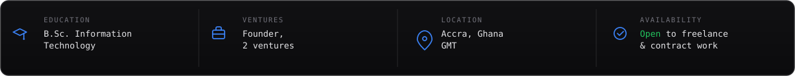
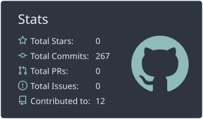
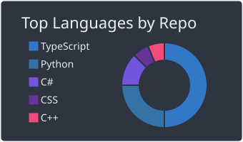
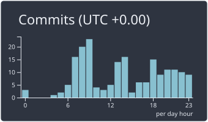

 

[About](#-about-me) · [Stack](#-tech-stack) · [Projects](#-featured-projects) · [Stats & Trophies](#-github-analytics) · [Now](#-currently) · [Connect](#-lets-connect)

 

 

## `$` About Me

I'm Frank, a full stack developer in Accra, Ghana.

My work centers on the **Next.js / TypeScript** stack end to end: multi tenant SaaS with proper data isolation and role based access, marketing sites that need to look and feel premium, and booking/service platforms with real forms, validation, and email delivery behind them. I also came up through university coursework in Information Technology, which is where the Python, Java, C#, and C++ side of my GitHub comes from.

I care about software that ships and holds up in production: clean data models, sane auth, and UI that doesn't feel like a template.

**Experience**

| Role | Organization |
|---|---|
| Founder | [INNOVISION GHANA](https://innovisiongh.com/) |
| Founder | [Sunleon Router Enterprise](https://www.sunleonrouterenterprise.com/) |
| Team Lead Developer | Gas Connect |
| Team Lead Developer | [Decorzone GH](https://decorzonegh.com/) |

 

## `$` Tech Stack

<table>
<tr><th scope="row">Languages</th><td></td></tr>
<tr><th scope="row">Frontend</th><td></td></tr>
<tr><th scope="row">Backend & Data</th><td></td></tr>
<tr><th scope="row">Tools & Deploy</th><td></td></tr>
</table>

 

## `$` Featured Projects

| | Project | What it is | Stack |
|---|---|---|---|
| 🏪 | **Vantage POS** [↗](https://the-vantage-pos.vercel.app) | Multi-tenant retail/pharmacy POS — 3 portals, per-tenant data isolation, optional pharmacy mode (prescriptions, controlled-substance logging, insurance claims) | Next.js · TS · PostgreSQL · Prisma · Tailwind |
| 🚗 | **ODIGOS** [↗](https://odigos-five.vercel.app) | Marketing & booking site for a private chauffeur service in Accra — animated transitions, validated forms | Next.js · TS · Tailwind · Framer Motion |
| 🏢 | **Sunleon Router Enterprise** [↗](https://www.sunleonrouterenterprise.com/) | Marketing site for a company I founded — filterable portfolio, services breakdown, one-time splash animation | React · Vite · Tailwind · React Router |
| 💜 | **LKCC Foundation** [↗](https://www.lkccfoundation.org/) | Nonprofit platform for the Lyndah Kayson Confidence Circle Foundation | Next.js · TS · Tailwind |
| 🔍 | **OCR Project** [↗](https://github.com/10954065/ocr-project) | Matches product photos to manufacturer catalog entries via OCR + computer vision — catalog ingestion (phase 2/3) complete | Next.js · TS · PostgreSQL+pgvector · Docker |
| ⛪ | **White Outreach Movement** [↗](https://www.whiteoutreachmovement.org/) | Ministry site — P2P video-call booking, sermons/events, Mobile Money giving; axe-core audited | Next.js · TS · Tailwind · Framer Motion |
| 🏍️ | **RIDA** | Motorcycle on-demand marketplace for Ghana — rides, deliveries, errands, rider-hire (architecture-first build) | NestJS · TS · Expo · PostgreSQL · Redis |
| 🌐 | **VYBE** [↗](https://github.com/10954065/VYBE) | Mobile-first social discovery platform — communities, events, check-ins, streaks; original product launching in Accra | React Native · Expo · Next.js · Supabase |
| 👗 | **Forme** [↗](https://github.com/10954065/3d-ecommerce) | Fashion e-commerce platform — garments shown on measured 3D mannequins instead of static photos | Next.js · TS · Three.js · PostgreSQL · Tailwind |
| 🏥 | **Sonotech Hospital ERP** | Self-hostable hospital ERP for a Ghanaian diagnostic center — 27 phases shipped (clinical, pharmacy, billing, theatre, blood bank, HR) | Next.js · TS · PostgreSQL · Prisma · Docker |
| ⚖️ | **Liberty ADR Centre** [↗](https://libertyadrcentreghana.com/) | Dispute-resolution centre site + staff admin — consultation requests saved, emailed, and sent to WhatsApp | Next.js · TS · PostgreSQL · Tailwind |
| 🧋 | **BOBA KING** [↗](https://bobaking-demo.vercel.app/) | Bubble tea ordering & store management — guest checkout, OTP, mobile money, kitchen/delivery/admin dashboards | PHP · MySQL · JavaScript |
| 📋 | **Kumasi Journey 2026** [↗](https://white-outreach-kumasi-journey.vercel.app) | Event registration platform — registration → admin review → SMS → QR check-in | Next.js · TS · Tailwind · PostgreSQL |
| 🌾 | **FarmAnchor Global** | Agribusiness marketing site sourcing produce from Ghanaian farms — on-the-fly PDF catalogue | Next.js · TS · Tailwind |

🔒 Private repos not linked to source above · case studies available on request

 

## `$` GitHub Analytics

 

 

 

 

 

## `$` Currently

| Status | Details |
|---|---|
| 🔭 **Building** | RIDA (Ghana ride & delivery marketplace) and VYBE (social discovery platform) |
| 🌱 **Deepening** | Turborepo/NestJS backend architecture and Expo/React Native app development across multi-app monorepos |
| 💼 **Open to** | Freelance and contract web development through [INNOVISION GHANA](https://innovisiongh.com/) |
| 📫 **Reach me** | [innovisiongh.com](https://innovisiongh.com/) · [sunleonrouterenterprise.com](https://www.sunleonrouterenterprise.com/) |

 

## `$` Let's Connect

 

Thanks for stopping by.

